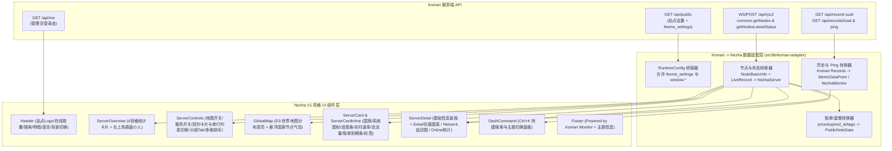

# Komari 探针「Nezha V1 风格」主题开发规划

已将两套探针的源码完整拉取至本地工作区并完成深度解读：
- **Komari 官方前端/默认主题**：[komari-web](file:///home/antigravity/ref/komari-web) 与文档 [komari-document](file:///home/antigravity/ref/komari-document)
- **Nezha V1 官方默认前端（nezha-dash-v1）**：[nezha-dash-v1](file:///home/antigravity/ref/nezha-dash-v1) 与后端 [nezha](file:///home/antigravity/ref/nezha)

> [!TIP]
> **核心发现：技术栈高度同源！**
> `nezha-dash-v1` 与 `komari-web` 均采用 **React 19 + TypeScript + Vite + Tailwind CSS v4 + shadcn/ui + Recharts + i18next + React Router** 构建。因此我们可以直接以 `nezha-dash-v1` 的视觉组件、动画和样式体系为基底，替换底层的数据通信层为 **Komari 数据适配层（Adapter Layer）**，实现像素级 1:1 复刻 Nezha 探针风格！

---

## 一、 源码架构与核心机制对比

| 维度 | Nezha V1 ([nezha-dash-v1](file:///home/antigravity/ref/nezha-dash-v1)) | Komari ([komari-web](file:///home/antigravity/ref/komari-web)) | 适配策略 |
| :--- | :--- | :--- | :--- |
| **前端路由** | `/`（首页列表）、`/server/:id`（详情页） | `/`（首页列表）、`/instance/:uuid`（详情页）；`/admin` 与 `/terminal` 由系统内置界面接管 | 同时支持 `/server/:uuid` 与 `/instance/:uuid` 路由别名，避开 `/admin` 与 `/terminal` |
| **实时状态获取** | WebSocket `/api/v1/ws/server` 推送 [`NezhaWebsocketResponse`](file:///home/antigravity/ref/nezha-dash-v1/src/types/nezha-api.ts#L1-L15) | JSON-RPC2 (`/api/rpc2` `common:getNodes` + `common:getNodesLatestStatus`) 或 WebSocket `/api/clients`（见 [`LiveDataContext.tsx`](file:///home/antigravity/ref/komari-web/src/contexts/LiveDataContext.tsx#L147-L211)） | 封装 `KomariAdapterProvider`，通过 Komari RPC2 / WebSocket 实时聚合并转换为 `NezhaWebsocketResponse` 结构 |
| **节点元数据** | 嵌在 WebSocket `server.host` + `public_note` JSON 中 | `common:getNodes` / `GET /api/nodes` 返回 [`NodeBasicInfo`](file:///home/antigravity/ref/komari-web/src/contexts/NodeListContext.tsx#L4-L56)（原生含 `price`、`billing_cycle`、`expired_at`、`traffic_limit`、`tags`、`group`） | 将 Komari 原生账单、流量限额、分组与标签字段自动映射为 Nezha 的 `billingDataMod`、`planDataMod` 与分组列表 |
| **历史负载图表** | `GET /api/v1/server/metrics`（CPU、内存、磁盘、进程、网络、TCP/UDP、GPU） | RPC2 `public:queryMetrics` / `common:getRecords` 或 `GET /api/records/load?uuid=&hours=` + `GET /api/recent/:uuid` | 改造 [`use-metric-history.ts`](file:///home/antigravity/ref/nezha-dash-v1/src/hooks/use-metric-history.ts#L10-L62)，实时模式用 `/api/recent/:uuid` + 增量缓冲，历史模式（4h / 1d / 7d / 30d）调 Komari 历史接口 |
| **网络监控 (Ping)** | `GET /api/v1/service/:id`（多监测点延迟折线图 + 削峰开关） | `GET /api/records/ping?uuid=&hours=` 或 RPC2 `public:getPingRecords` + `public:getPublicPingTasks` | 将 Komari 的 Ping Tasks 映射为 Nezha [`NetworkChart.tsx`](file:///home/antigravity/ref/nezha-dash-v1/src/components/NetworkChart.tsx#L54-L170) 的 `NezhaMonitor[]` 格式，完整保留多任务切换与削峰（Peak Cut） |
| **服务状态 & 流量周期** | `GET /api/v1/service`（30天可用率条 + 周期流量进度卡片） | 节点自带 `traffic_limit` / `traffic_limit_type`，Ping 任务自带丢包/延迟统计 | 用节点的 `traffic_limit` 驱动 [`CycleTransferStats.tsx`](file:///home/antigravity/ref/nezha-dash-v1/src/components/CycleTransferStats.tsx#L12-L90) 流量进度卡；用公开 Ping 任务统计驱动 [`ServiceTracker.tsx`](file:///home/antigravity/ref/nezha-dash-v1/src/components/ServiceTracker.tsx#L38-L105) |
| **主题自定义配置** | `window.CustomBackgroundImage`、`window.ShowNetTransfer` 等全局变量（[`runtime-config.ts`](file:///home/antigravity/ref/nezha-dash-v1/src/features/runtime-config/runtime-config.ts#L10-L28)） | [`komari-theme.json`](file:///home/antigravity/ref/komari-web/komari-theme.json#L9-L161) `configuration` (`managed` 表单)，通过 `GET /api/public` 的 `data.theme_settings` 下发 | **双模兼容**：既支持 Komari 后台可视化表单配置（`theme_settings`），也兼容用户自定义头部脚本注入 `window.*` 变量 |
| **模板占位符规范** | Go 模板替换 `{{.Title}}` 等 | [`index.html`](file:///home/antigravity/ref/komari-web/index.html#L6-L75) 必须包含 `<title>Komari Monitor</title>` 与 `<meta name="description" content="A simple server monitor tool." />`，页脚保留 `Powered by Komari Monitor.` | 严格遵循 Komari 服务端 HTML 替换规则与 `localStorage` (`appearance`, `language`) 键名规范 |

---

## 二、 系统架构与数据流设计

---

## 三、 核心字段与功能映射方案

### 1. 节点信息与实时状态映射 (`NodeBasicInfo` + `LiveRecord` $\rightarrow$ `NezhaServer`)
Komari 使用字符串 `uuid` 作为节点唯一标识，而 `nezha-dash-v1` 使用数字 `id`。我们将：
- 在内部为每个 `uuid` 分配稳定的索引或直接将路由参数改为支持 `uuid`（`/server/:uuid` 与 `/instance/:uuid` 均可访问）。
- **基础硬件 (`host`)**：
  - `node.os` $\rightarrow$ `host.platform`（自动匹配 Ubuntu/Debian/CentOS/Alpine/Windows/macOS 等 `font-logos` 发行版图标，见 [`logo-class.tsx`](file:///home/antigravity/ref/nezha-dash-v1/src/lib/logo-class.tsx)）
  - `node.kernel_version` $\rightarrow$ `host.platform_version`
  - `[`${node.cpu_name} (${node.cpu_cores} Cores)`]` $\rightarrow$ `host.cpu`
  - `node.gpu_name` $\rightarrow$ `host.gpu`
  - `node.mem_total` / `disk_total` / `swap_total` / `arch` / `version` 一一对应。
- **实时状态 (`state`)**：
  - `cpu.usage` $\rightarrow$ `state.cpu`
  - `ram.used` / `swap.used` / `disk.used` $\rightarrow$ `state.mem_used` / `swap_used` / `disk_used`
  - `network.up` / `down` / `totalUp` / `totalDown` $\rightarrow$ `net_out_speed` / `net_in_speed` / `net_out_transfer` / `net_in_transfer`
  - `load.load1` / `load5` / `load15` $\rightarrow$ `load_1` / `load_5` / `load_15`
  - `connections.tcp` / `udp`、`process`、`uptime` 一一对应。
- **国旗与地区 (`region` $\rightarrow$ `country_code`)**：
  - Komari 的 `node.region` 可能是 ISO 两字母代码（如 `JP`, `US`, `HK`）或旗帜 Emoji（如 `🇯🇵`），编写转换函数统一转为两字母国家码，完美适配 [`ServerFlag.tsx`](file:///home/antigravity/ref/nezha-dash-v1/src/components/ServerFlag.tsx) 与 [`GlobalMap.tsx`](file:///home/antigravity/ref/nezha-dash-v1/src/components/GlobalMap.tsx)。

### 2. 原生账单、到期时间、流量限额与标签映射
Nezha V1 通过解析 `public_note` JSON 来展示价格、剩余天数进度条、套餐标签和周期流量；而 **Komari 原生就在节点数据结构中内置了这些字段**！我们可以直接无损合成：
1. **账单与到期进度条 ([`billingInfo.tsx`](file:///home/antigravity/ref/nezha-dash-v1/src/components/billingInfo.tsx))**：
   - 读取 Komari 节点的 `price`、`currency`、`billing_cycle`（自动映射月付/季付/半年付/年付等）、`expired_at`、`auto_renewal`，直接生成 Nezha 卡片上的价格文本、剩余天数及彩色剩余百分比进度条（[`RemainPercentBar.tsx`](file:///home/antigravity/ref/nezha-dash-v1/src/components/RemainPercentBar.tsx)）。
   - 同时兼容用户在 `public_remark` 中手写 Nezha 格式 JSON 的情况。
2. **套餐与自定义标签 ([`PlanInfo.tsx`](file:///home/antigravity/ref/nezha-dash-v1/src/components/PlanInfo.tsx))**：
   - 读取 Komari 节点的 `ipv4` / `ipv6` 状态生成 `IPv4` / `IPv6` 彩色微章。
   - 读取 `traffic_limit` 生成流量配额微章。
   - 读取 `tags`（以 `;` 分隔，支持 Komari 的 `<color>` 语法）渲染为 Nezha 风格的精致圆角标签。
3. **周期流量统计卡片 ([`CycleTransferStats.tsx`](file:///home/antigravity/ref/nezha-dash-v1/src/components/CycleTransferStats.tsx))**：
   - 对于设置了 `traffic_limit > 0` 的节点，根据 `traffic_limit_type`（`max` / `min` / `sum` / `up` / `down`）自动计算当前已用流量与限额百分比，在「服务/流量」折叠区展示 Nezha 同款流量进度卡片。

### 3. 后台动态配置 (`komari-theme.json`) 设计
利用 Komari `>= 1.0.5` 的 `managed` 动态配置能力，在 Komari 管理后台直接提供可视化的 Nezha 主题开关，无需手写 JS 代码（同时保留 `window.*` 兼容）：

| 配置 Key | 类型 | 默认值 | 说明 |
| :--- | :--- | :--- | :--- |
| `customLogo` | `string` | `""` | 自定义左上角 Logo URL |
| `customDesc` | `string` | `""` | 副标题描述（留空则使用站点描述） |
| `customLinks` | `string` | `""` | 导航栏外链 JSON，如 `[{"name":"GitHub","link":"..."}]` |
| `backgroundImage` | `string` | `""` | 桌面端自定义背景图 URL（开启后卡片自动半透明毛玻璃） |
| `mobileBackgroundImage` | `string` | `""` | 移动端自定义背景图 URL |
| `disableAnimatedMan` | `switch` | `false` | 是否隐藏总览卡片右上角的经典 Nezha 跳动小人插画 |
| `customIllustration` | `string` | `""` | 自定义右上角插画图片 URL（默认使用内置 `animated-man.webp`） |
| `showNetTransfer` | `switch` | `true` | 在网格卡片底部显示总上传/总下载流量胶囊 Badge |
| `fixedTopServerName` | `switch` | `false` | 固定服务器名称在卡片顶部（显示系统发行版图标列） |
| `forceCardInline` | `switch` | `false` | 默认使用单行紧凑列表视图（Inline Row 模式） |
| `forceShowMap` | `switch` | `false` | 首页默认展开全球节点分布地图 |
| `forceShowServices` | `switch` | `false` | 首页默认展开流量周期与 Ping 服务监控面板 |
| `forceUseSvgFlag` | `switch` | `true` | 强制使用 SVG 国旗代替 Emoji |
| `forcePeakCutEnabled` | `switch` | `false` | 网络监控延迟图默认开启 EWMA 削峰平滑 |
| `forceTheme` | `select` | `"system"` | 默认明暗模式（`system` / `light` / `dark`） |

---

## 四、 分阶段开发实施步骤

### 阶段 1：项目脚手架初始化与静态资源迁移
1. 在 `/home/antigravity/komari-theme-nezha` 初始化主题项目，复用 `nezha-dash-v1` 的 Tailwind CSS v4 配置（[`src/index.css`](file:///home/antigravity/ref/nezha-dash-v1/src/index.css)）、UI 组件库（[`src/components/ui/`](file:///home/antigravity/ref/nezha-dash-v1/src/components/ui)）、字体图标（`font-logos`、`flag-icons`）与静态插画资源（`animated-man.webp` 等）。
2. 按 Komari 规范编写 [`index.html`](file:///home/antigravity/ref/komari-web/index.html)（包含必需的 `<title>Komari Monitor</title>` 与 `<meta name="description" content="A simple server monitor tool." />` 占位符，以及首屏防闪烁 `appearance` 明暗脚本）。
3. 编写 `komari-theme.json` 与一键打包脚本 `build-theme.sh`。

### 阶段 2：Komari 数据通信与适配层开发 (`src/lib/komari-adapter.ts`)
1. **RPC2 与实时状态流**：复用/精简 [`RPC2Client`](file:///home/antigravity/ref/komari-web/src/contexts/RPC2Context.tsx)，每 2 秒轮询 `common:getNodesLatestStatus`（并维护内存级 `messageHistory` 环形缓冲区供详情页 Realtime 图表使用）。
2. **站点配置与登录态**：对接 `GET /api/public` 与 `GET /api/me`，点击右上角「登录 / 管理面板」按钮直接跳转 Komari 的 `/admin`。
3. **数据转换器**：将 Komari 节点、分组（`node.group`）、账单、标签、流量配额转换为 Nezha 组件所需结构。
4. **存储键兼容**：将主题明暗切换绑定至 `localStorage.getItem("appearance")`，语言切换绑定至 `localStorage.getItem("language")`，与 Komari 默认主题及后台无缝同步。

### 阶段 3：首页 (`Server.tsx`) 与核心组件复刻
1. **顶部导航栏 ([`Header.tsx`](file:///home/antigravity/ref/nezha-dash-v1/src/components/Header.tsx))**：Logo、站点名、副标题、外链、后台入口、搜索按钮（触发 `Ctrl+K` [`DashCommand`](file:///home/antigravity/ref/nezha-dash-v1/src/components/DashCommand.tsx)）、语言切换、明暗切换、背景图快速隐藏开关、实时在线人数状态胶囊（带仓鼠旋转 Loader）。
2. **总览统计区 ([`ServerOverview.tsx`](file:///home/antigravity/ref/nezha-dash-v1/src/components/ServerOverview.tsx))**：实时跳动的时间展示 + 4 张可点击过滤（全部/在线/离线/网络速率与总流量）的统计卡片 + 右上角 `animated-man.webp` 悬浮插画。
3. **控制栏 ([`server-controls.tsx`](file:///home/antigravity/ref/nezha-dash-v1/src/features/servers/server-controls.tsx))**：全球地图开关、服务/周期流量开关、双列卡片/单行列表视图切换、分组滑动指示器 Tab（[`GroupSwitch.tsx`](file:///home/antigravity/ref/nezha-dash-v1/src/components/GroupSwitch.tsx)）、多指标正反序排列下拉框。
4. **节点展示区**：
   - 双列网格卡片 ([`ServerCard.tsx`](file:///home/antigravity/ref/nezha-dash-v1/src/components/ServerCard.tsx)) 与单行宽表卡片 ([`ServerCardInline.tsx`](file:///home/antigravity/ref/nezha-dash-v1/src/components/ServerCardInline.tsx))
   - 全球分布地图 ([`GlobalMap.tsx`](file:///home/antigravity/ref/nezha-dash-v1/src/components/GlobalMap.tsx))
   - 周期流量与 Ping 监控概览 ([`ServiceTracker.tsx`](file:///home/antigravity/ref/nezha-dash-v1/src/components/ServiceTracker.tsx))
5. **页脚 ([`Footer.tsx`](file:///home/antigravity/ref/nezha-dash-v1/src/components/Footer.tsx))**：遵循 Komari 规范保留 `Powered by Komari Monitor.`，同时保留 `Ctrl+K` 快捷键提示与主题标识。

### 阶段 4：详情页 (`ServerDetail.tsx`) 与图表适配
1. **硬件与状态概览 ([`ServerDetailOverview.tsx`](file:///home/antigravity/ref/nezha-dash-v1/src/components/ServerDetailOverview.tsx))**：展示状态徽章、在线时长、版本、架构、内存、磁盘、地区国旗、系统、CPU、GPU、Load (1m/5m/15m)、总上传/下载、温度传感器、最后上报时间。
2. **Detail 负载图表 ([`ServerDetailChart.tsx`](file:///home/antigravity/ref/nezha-dash-v1/src/components/ServerDetailChart.tsx))**：
   - 支持 `Realtime`（使用 `/api/recent/:uuid` + 实时追加数据）与历史时段（`4h` / `1d` / `7d` / `30d`，调用 Komari `/api/records/load` 或 `public:queryMetrics`）。
   - 包含 CPU、GPU、内存+Swap、磁盘、进程数、网络速率、TCP/UDP 连接数 7 类同步十字准星图表（AreaChart / LineChart + 圆形进度环）。
3. **Network 延迟图表 ([`NetworkChart.tsx`](file:///home/antigravity/ref/nezha-dash-v1/src/components/NetworkChart.tsx))**：
   - 对接 Komari `/api/records/ping?uuid=&hours=`，展示各 Ping 探测任务的平均延迟、丢包率与多线路对比折线图，支持削峰（Peak Cut）平滑算法。
4. **Online 在线历史 ([`ServerDetailOnlineHistory.tsx`](file:///home/antigravity/ref/nezha-dash-v1/src/components/ServerDetailOnlineHistory.tsx))**：
   - 基于 Komari 的历史心跳/Ping 记录推算在线时段与每日可用率色块条。

### 阶段 5：编译验证、预览图生成与主题包打包
1. 运行 TypeScript 类型检查与 Vite 生产构建，确保零报错。
2. 使用模拟数据在本地预览并校验亮色/暗色模式、移动端/桌面端响应式布局，生成 `preview.webp` 预览图。
3. 执行 `build-theme.sh` 产出符合 Komari 主题市场规范的 `komari-theme-nezha-*.zip` 安装包（根目录含 `komari-theme.json`、`preview.webp` 及 `dist/`）。
