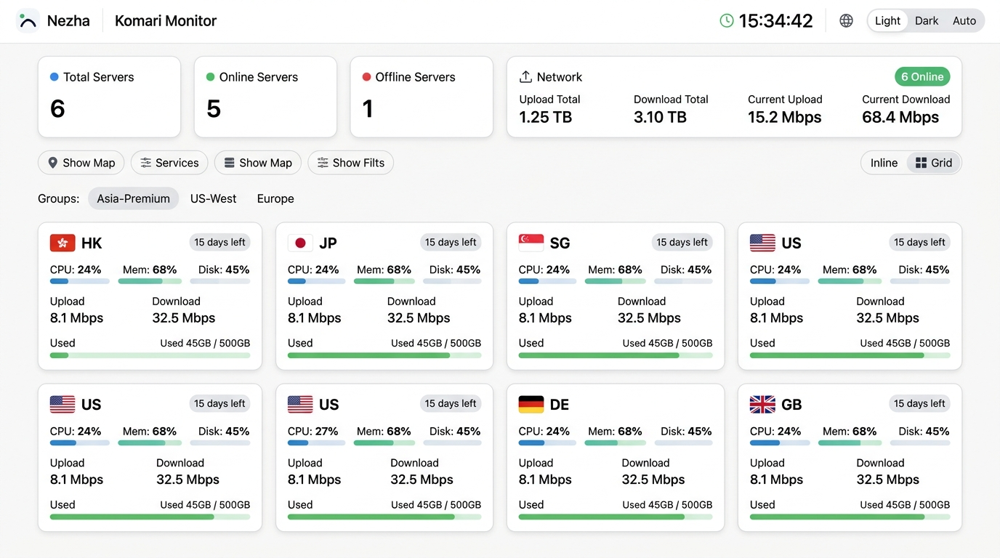

# Komari Theme Zachary

<div align="center">

**适用于 [Komari Monitor](https://github.com/komari-monitor/komari) 的哪吒 V1 风格增强主题**

基于 [nezha-dash-v1](https://github.com/hamster1963/nezha-dash-v1) 设计，新增 **多币种实时汇率 VPS 剩余价值计算**、**卡片周期流量进度条** 与 **节点详情账单/硬件面板**。

[](./LICENSE)
[](https://github.com/huge1225/komari-theme-zachary)



</div>

---

## 📦 安装教程

### 方式一：通过 ZIP 直链在线导入（推荐）
1. 进入 Komari 管理后台 -> **主题管理** -> **导入远程主题**。
2. 填入以下 ZIP 下载直链即可直接导入：
   ```text
   https://raw.githubusercontent.com/huge1225/komari-theme-zachary/main/komari-theme-nezha.zip
   ```
   > 备用链接：`https://github.com/huge1225/komari-theme-zachary/raw/main/komari-theme-nezha.zip`

### 方式二：本地上传 ZIP 安装
1. 点击下载仓库中的 [`komari-theme-nezha.zip`](https://github.com/huge1225/komari-theme-zachary/raw/main/komari-theme-nezha.zip)。
2. 在 Komari 管理后台 -> **主题管理** 中上传该 `.zip` 文件并启用。

---

## ✨ 主要特性

- **VPS 剩余价值实时折算**：自动读取节点的续费价格、币种、周期与到期时间，结合实时汇率计算单机及全部 VPS 剩余总价值，支持一键切换 `CNY` / `USD` / `HKD` / `EUR` 与价值排行榜。
- **周期流量进度条**：当节点配置了流量限额后，在首页卡片底部直观显示周期已用流量与百分比（支持 `sum` / `max` / `min` / `up` / `down` 计费模式及三色告警）。
- **节点详情全量面板**：子页面展示单机剩余价值、月均/日均成本、虚拟化架构、Swap、连接数/进程数、多目标 Ping 延迟曲线（支持 EWMA 削峰）及 30 天在线率。
- **后台可视化配置**：支持在 Komari 后台直接设置自定义 Logo、副标题、导航链接、桌面/手机壁纸、默认视图模式（网格/单行列表）、默认展开全球地图等 16 项参数。

---

## 🛠️ 本地开发与打包

```bash
# 安装依赖
pnpm install

# 本地预览（支持 ?mock=1 演示数据）
pnpm run dev

# 编译并打包生成 komari-theme-nezha.zip
./build-theme.sh
```

---

## 📜 开源协议

基于 [Apache License 2.0](./LICENSE) 开源。UI 源自 [hamster1963/nezha-dash-v1](https://github.com/hamster1963/nezha-dash-v1)，由 **Zachary** ([@huge1225](https://github.com/huge1225)) 适配 Komari 并维护。
